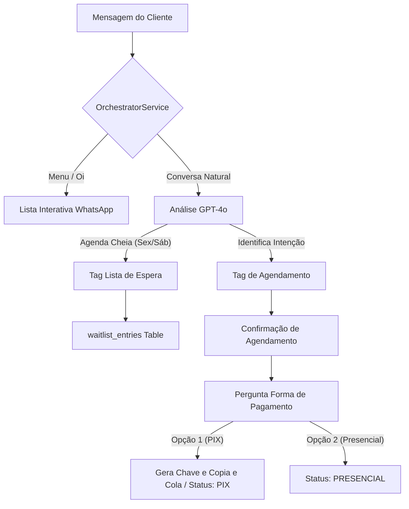
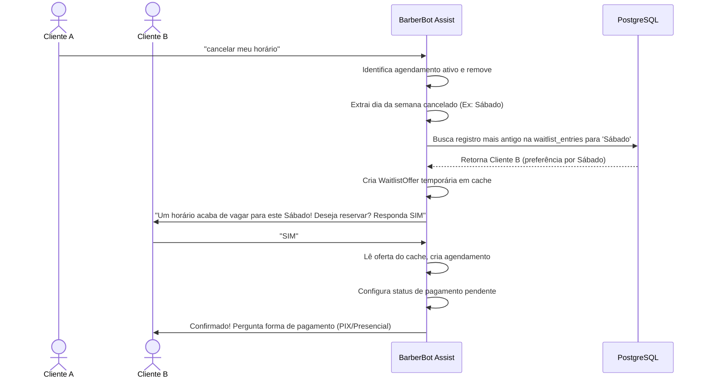
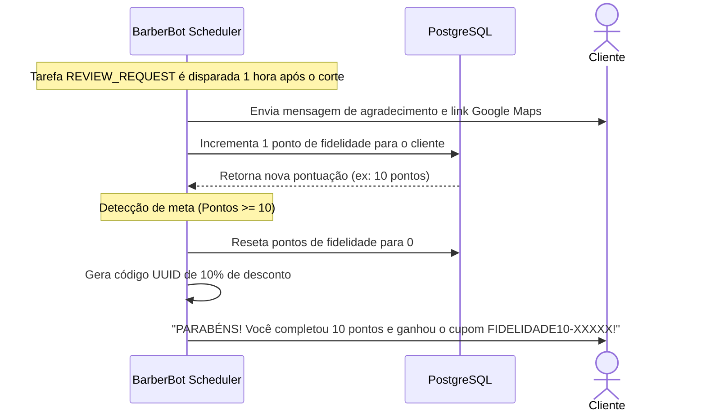
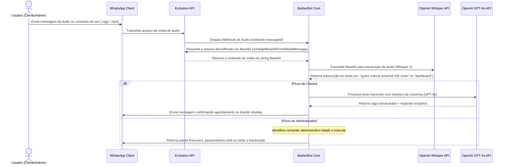

# 💈 BarberBot AI - Sistema de Agendamento Autônomo & CRM (MVP Completo)

> **SaaS de Automação de Atendimento, Agendamento e Vendas via WhatsApp para Barbearias e Centros de Estética**
>
> Arquitetura corporativa escalável desenvolvida com **Spring Boot 3**, **PostgreSQL**, **Flyway**, e **OpenAI (GPT-4o & Whisper)**. Integração de mensageria assíncrona robusta via **Evolution API** projetada para operação 100% autônoma e otimização de faturamento comercial.

---

## 🚀 1. Visão Geral e Proposta de Valor Comercial (MVP)

O **BarberBot** é uma plataforma SaaS *white-label* pronta para ser validada e escalada em ambiente real de produção. Diferente de chatbots tradicionais baseados em fluxogramas engessados e opções numéricas limitadas, o BarberBot combina a flexibilidade e a empatia do processamento de linguagem natural (NLP) com a precisão de um banco de dados relacional e automações de reengajamento ativo para impulsionar a receita recorrente e otimizar processos internos.

### 💰 Impacto de Negócio do MVP
1. **Desperdício Zero de Agenda (Lista de Espera Reativa)**: Vagas perdidas por cancelamentos de última hora em sextas-feiras e sábados são preenchidas de forma autônoma. O sistema notifica imediatamente a primeira pessoa da lista de espera e fecha o agendamento sem intervenção manual.
2. **Ciclo de Retorno Reduzido (Retenção de Clientes)**: Reduz o tempo de inatividade entre cortes enviando lembretes proativos de forma personalizada a cada 15 dias. Um cliente que passa a vir a cada 20 dias em vez de 40 **dobra a sua receita recorrente** dentro do estabelecimento.
3. **Fidelização com Gamificação Própria (Cartão Fidelidade Digital)**: Promove uma experiência livre de cartões físicos de papel, aumentando a retenção de forma astronômica e garantindo a recorrência na base de clientes.
4. **Fricção Zero no Pagamento (Pix Copia e Cola)**: Disponibiliza a chave e o código Pix imediatamente após a reserva do horário, diminuindo o fluxo de atendimento físico e agilizando as operações no caixa.

---

## 🧠 2. Diagramas de Fluxo e Arquitetura do Sistema

### 2.1. Arquitetura Geral do Fluxo de Mensagens
Este diagrama demonstra como o sistema recebe a mensagem do cliente via WhatsApp, processa por meio da Inteligência Artificial do GPT-4o, realiza o tratamento de tags estruturadas em segundo plano e direciona para os fluxos de agendamento, lista de espera e checkout de pagamento.



### 2.2. Sequência Reativa: Cancelamento de Horário & Lista de Espera
Esta sequência demonstra o funcionamento concorrente e reativo da Lista de Espera. No momento em que um cliente cancela seu horário, o sistema atua imediatamente para reabsorver a vaga, oferecendo-a para o primeiro da lista de espera para o mesmo dia da semana.



### 2.3. Sequência de Fidelidade Digital (Pós-Serviço)
Esta sequência detalha a lógica de banco de dados relacional e gamificação aplicada após o término do corte de cabelo. O sistema incrementa a pontuação em segundo plano e, ao atingir a meta, emite o código promocional exclusivo.



### 2.4. Fluxo de Compreensão e Processamento de Áudio (OpenAI Whisper-1)
Este diagrama detalha o funcionamento assíncrono e concorrente da recepção de áudio no sistema. O bot baixa o arquivo de voz do WhatsApp de forma transparente via API do Evolution, decodifica a mídia e utiliza a inteligência artificial do Whisper para transcrever a voz em texto de alta fidelidade, permitindo processar a intenção do cliente na recepção ou executar comandos administrativos remotamente por voz.



---

## 🛠️ 3. Mapeamento e Especificação dos Módulos do Sistema

### MÓDULO A: INTEGRAÇÃO INTELIGENTE DE ATENDIMENTO (CLIENTE)
* **Inteligência Artificial Conversacional (NLP - OpenAI GPT-4o)**: Compreensão de linguagem natural, gírias e agendamentos diretos em conversas livres por chat.
* **Extração Temática de Tags de IA**: Geração e interceptação em milissegundos das tags `[NOVO_AGENDAMENTO|...]` e `[LISTA_DE_ESPERA|...]` sem exibição visual ao cliente.
* **Compreensão de Áudio em Tempo Real (OpenAI Whisper)**: O cliente pode fazer agendamentos, cancelar horários ou tirar dúvidas enviando mensagens de voz normais no WhatsApp. O sistema realiza o download dinâmico do áudio, faz a transcrição de alta fidelidade nativamente e processa o texto pela inteligência do GPT-4o como se tivesse sido digitado, respondendo o cliente com agilidade e fluidez.
* **Menus Nativos Interativos (WhatsApp List Messages)**: Interface de gaveta clicável nativa do WhatsApp com fallback numérico robusto (1 a 8) e reconciliação total de rotas.
* **Autogestão de Agendamentos**: Possibilidade de o cliente consultar seu horário ativo ou cancelá-lo informando apenas a frase `"cancelar meu horário"`.

### MÓDULO B: AUTOMAÇÕES FINANCEIRAS & FIDELIZAÇÃO
* **Cartão Fidelidade Digital**: Acúmulo automático de **1 ponto** na conta do Postgres toda vez que o cliente conclui a rotina de pós-venda. Zera ao chegar a **10 pontos** e envia um cupom promocional único de **10% de desconto** (`FIDELIDADE10-[HASH]`).
* **Retenção Inteligente ("Cabelo Crescido")**: Motor diário rodando via CRON às **11h00** que busca inativos por ciclos de **15 dias** e dispara lembretes calorosos se não houver reserva futura.
* **Lista de Espera Reativa (Sexta & Sábado)**: Fila automatizada persistida na tabela `waitlist_entries` quando a agenda do fim de semana está lotada. Preenche a vaga de forma concorrente e avisa o cliente da lista com auto-booking sob resposta `"SIM"`.
* **Checkout PIX Copia e Cola**: Fluxo imediato de pagamento pós-agendamento com payloads formatados e badges visuais (`[PIX 💳]`, `[Presencial 💵]`, `[Pendente ⏳]`) no fechamento do dia do administrador.

### MÓDULO C: PAINEL ADMINISTRATIVO & CRM (ADMINISTRADOR)
* **Controle Total por Comandos de Voz**: O proprietário/administrador pode comandar a barbearia por mensagens de áudio no WhatsApp! O Whisper transcreve a voz e o sistema executa o comando correspondente diretamente (ex: falar *"dashboard"* para ver faturamento, *"relatório matinal"* ou *"relatório noturno"*, *"pausar"* ou *"retomar"* o robô para clientes específicos). O bot também retorna a transcrição de voz no chat para acompanhamento visual.
* **Dashboard Financeiro**: Resumo estimado de faturamento e cortes efetuados no chat administrativo.
* **Relatório Matinal Automatizado (07h30)**: Disparo diário com a contagem de clientes agendados e a listagem das horas de cada atendimento.
* **Relatório Noturno Detalhado (22h30)**: Fechamento detalhado dos serviços do dia integrados com as badges de pagamento de cada cliente.
* **Importação via Visão Computacional (IA Vision)**: O administrador envia a foto de uma agenda física e a IA mapeia e cadastra todos os horários e clientes automaticamente no banco de dados.
* **Importação de Leads em Lote (CSV)**: Decodificação e cadastro de base de clientes inteira enviando um arquivo de planilha CSV no chat.
* **Transbordo Humano & Pausa Inteligente**: Silenciamento do robô para um cliente específico durante **15 minutos** quando ele solicita falar com o barbeiro, com triagem de motivos disparada para o administrador.
* **CRUD de Clientes**: Possibilidade de listar toda a base relacional ou deletar um contato permanentemente via chat de controle.

### MÓDULO D: RESILIÊNCIA E ARQUITETURA DE DADOS
* **Persistência Híbrida de Estado (JSON + RDBMS)**: Salvamento automático da agenda em cache e em arquivo físico `agenda.json`. Restabelece o estado da aplicação e horários indisponíveis no `@PostConstruct` caso o servidor sofra reinício inesperado.
* **Fila e Motor de Disparo de Lembretes (Scheduled Tasks)**: Tabela `scheduled_tasks` que programa lembretes (`REMINDER` 1 hora antes) e pós-venda (`REVIEW_REQUEST` 1 hora depois), adiando envios caso o robô esteja em pausa de transbordo humano.

---

## 🏗️ 4. Modelo do Banco de Dados Relacional (Flyway)

Para garantir integridade transacional e implantação limpa do MVP em produção, as novas colunas e tabelas foram estruturadas em migrações gerenciadas pelo **Flyway**.

### Script de Migração (`V2__add_fidelity_waitlist.sql`)

```sql
-- 1. Adiciona colunas para controle de fidelidade e última visita na tabela de clientes
ALTER TABLE customers ADD COLUMN fidelity_points INTEGER DEFAULT 0;
ALTER TABLE customers ADD COLUMN last_service_date TIMESTAMP;

-- 2. Tabela de Lista de Espera Inteligente
CREATE TABLE waitlist_entries (
    id UUID PRIMARY KEY,
    customer_phone VARCHAR(20) NOT NULL,
    customer_name VARCHAR(255),
    preferred_day VARCHAR(50) NOT NULL,
    created_at TIMESTAMP NOT NULL
);

-- 3. Índices de performance para busca reativa eficiente
CREATE INDEX idx_waitlist_day ON waitlist_entries(preferred_day);
CREATE INDEX idx_waitlist_phone ON waitlist_entries(customer_phone);
```

---

## 📂 5. Estrutura do Projeto

O sistema é construído sobre pilares de **Clean Architecture** e forte modularização, separando os controladores REST das regras de negócio.

```
barberbot-core
 ├── src/main/java/com/barberbot/api
 │    ├── controller      # Controllers REST (Webhook Evolution API)
 │    ├── repository      # Repositories JPA (Spring Data)
 │    ├── model           # Entidades JPA (Customer, WaitlistEntry, Tasks, Interaction)
 │    ├── service         # Camada de Negócio (Orchestrator, OpenAI, WhatsApp, Agenda)
 │    ├── scheduler       # Agendadores CRON e Processamento de Filas
 │    └── config          # Configurações de Properties, WebClient e OpenAI
 └── src/main/resources
      ├── db/migration    # Migrações Flyway SQL (V1, V2)
      └── application.yml # Configuração de preços, serviços e APIs
```

---

## ⚙️ 6. Instalação, Deploy e Inicialização do MVP

### 6.1. Configurar Variáveis de Ambiente (`.env`)
Antes de iniciar a aplicação, garanta a criação do arquivo `.env` na raiz do projeto:

```env
# Conexão PostgreSQL
SPRING_DATASOURCE_URL=jdbc:postgresql://localhost:5432/barberbot_db
SPRING_DATASOURCE_USERNAME=seu_usuario
SPRING_DATASOURCE_PASSWORD=sua_senha

# Chaves de Integração e APIs
OPENAI_API_KEY=sk-proj-xxxxxxxxxxxxxxxxxxxxxxxxxxxxxxxx
ADMIN_PHONE=5511999999999
EVOLUTION_API_KEY=barberbot
```

### 6.2. Inicialização em Produção/Desenvolvimento
Execute o script utilitário de inicialização em sistemas Windows:

```powershell
./run.ps1
```

O Flyway se encarrega de verificar a versão do banco de dados, criar os campos de fidelidade e tabela de lista de espera de forma transparente e segura, permitindo o funcionamento imediato do bot.

---
*BarberBot AI MVP: Automação completa de atendimento, fidelidade reativa e controle financeiro de ponta a ponta na palma da mão.* ✂️💈
