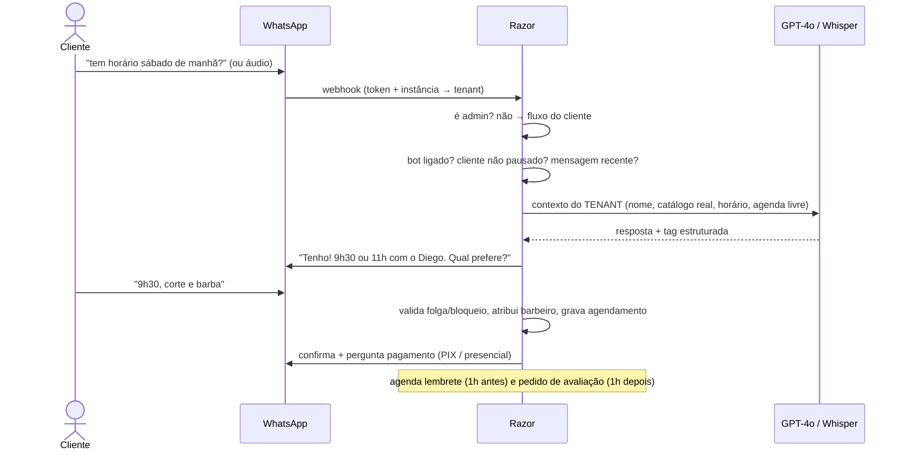

# 🪒 RAZOR — O sistema operacional inteligente da barbearia

> **SaaS multi-tenant** de atendimento e gestão para barbearias: uma **IA conversacional** atende,
> agenda e cobra pelo WhatsApp enquanto o dono acompanha tudo por um **painel web**.
>
> **Spring Boot 3 · PostgreSQL + Flyway · OpenAI (GPT-4o + Whisper) · Evolution API · React (Vite + TS)**

Documentação viva em [`docs/`](./docs): [ROADMAP](./docs/ROADMAP.md) · [PLATFORM](./docs/PLATFORM.md) ·
[PRICING](./docs/PRICING.md) · [BRANDING](./docs/BRANDING.md) · [UX_BLUEPRINT](./docs/UX_BLUEPRINT.md) ·
[WHATSAPP_CHANNEL](./docs/WHATSAPP_CHANNEL.md) · [COMPETITIVE_ANALYSIS](./docs/COMPETITIVE_ANALYSIS.md)

---

## 1. O que o Razor é (e para quem)

Plataforma **B2B2C** com três públicos e três superfícies distintas:

| Nível | Quem | Onde usa | O que faz |
|---|---|---|---|
| **Plataforma** | dono do Razor | console do dono *(Fase 4)* | vê todas as barbearias, MRR, custo de IA por tenant, suporte |
| **Barbearia** (tenant) | dono / equipe | **painel web** + **WhatsApp admin** | configura tudo no painel; opera o dia a dia pelo celular |
| **Cliente final** | cliente da barbearia | **WhatsApp** (e o site da barbearia, Fase 3) | agenda, tira dúvidas, é atendido pela IA |

**Princípio que organiza o produto:** *configuração e relatórios vivem no **web**; o **WhatsApp** é
operação rápida.* Financeiro, comissões e fechamento saíram do WhatsApp e ficam no painel; no celular
o dono tem só o que precisa entre um corte e outro.

---

## 2. Os três fluxos, na prática

### 2.1. Fluxo do CLIENTE (WhatsApp, sem baixar nada)

O cliente conversa em linguagem natural — texto **ou áudio**. Não existe "digite 1".



**O que o cliente consegue fazer sozinho:** agendar, escolher o barbeiro, ver/cancelar o próprio
horário, consultar endereço, preços e Instagram, entrar na lista de espera, pagar por PIX, acumular
fidelidade e pedir para **falar com um humano** (o bot se cala por 15 min e avisa o dono).

### 2.2. Fluxo do ADMIN no CELULAR (WhatsApp = controle remoto)

O celular **não é um painel menor** — é o controle rápido. Qualquer telefone cadastrado como admin
da barbearia cai neste fluxo (inclusive por **comando de voz**, transcrito pelo Whisper).

> **📱 São dois números diferentes — e precisam ser:**
> | | Qual número | Papel |
> |---|---|---|
> | **Bot** | o **da barbearia** (idealmente um WhatsApp só dela) | é o que o cliente vê e o que se pareia pelo QR |
> | **Admin** | o **pessoal do dono** / da equipe | comanda o bot e recebe os alertas |
>
> Se o admin usar o **mesmo** número do bot, as mensagens dele chegam como `fromMe` e são
> descartadas na triagem — ele não conseguiria dar nenhum comando.

O admin **não precisa decorar comandos**: fala natural (*"agenda de hoje"*, *"manda um aviso"*,
*"pausar cliente"*). Digitar **`menu`** sempre mostra a lista completa.

Digitando `menu`, o dono recebe:

```
🛠️ PAINEL DA BARBEARIA — ações rápidas
 1 - 📅 Agenda do Dia          6 - ⏸️ Pausar bot (cliente)
 2 - 📆 Agenda da Semana       7 - ▶️ Retomar bot (cliente)
 3 - 📢 Avisos (geral)         8 - 📋 Listar clientes
 4 - 🎯 Promoções do dia       9 - 🗑️ Apagar um cliente
 5 - 📝 Agendar disparo       10 - ℹ️ Ajuda / manual

📊 Financeiro, comissões e fechamento: no painel web.
```

Além do menu, o admin pode pelo celular:
- **Mandar áudio** com o comando (ex.: *"agenda do dia"*) — o Whisper transcreve e executa;
- **Enviar a foto de uma agenda de papel** — a IA (Vision) lê e cadastra os horários;
- **Enviar um CSV** — importa a base de clientes inteira;
- **Receber alertas** automáticos: relatório matinal, fechamento do dia, aviso quando um cliente
  pede atendimento humano.

Pedir "financeiro" ou "comissões" no WhatsApp **redireciona para o painel** de propósito — relatório
comprido não se lê no celular entre dois cortes.

### 2.3. Fluxo do DONO no PAINEL WEB (onde se configura tudo)

`Painel` (cockpit do dia) · **`Agenda`** (calendário por barbeiro, estilo Google Agenda) ·
`Clientes` (base, assinantes do clube) · `Serviços` · `Profissionais` (+ comissão) · `Planos` ·
`Comissões` · `Configurações` · `Meu perfil`.

Em **Configurações** o dono resolve o essencial:
- **Status do bot** — semáforo: WhatsApp conectado? IA funcionando? atendimento ligado? (+ liga/desliga)
- **Conectar o WhatsApp** — **QR code na própria tela**, sem abrir a Evolution
- **O que o bot fala** — nome, endereço, **chave PIX**, horário de funcionamento, tabela de serviços,
  saudação, lembrete, pedido de avaliação, política de cancelamento e a **persona da IA**

---

## 3. Arquitetura

```
WhatsApp ──▶ Evolution API ──▶ POST /api/webhook?token=… ──▶ WebhookRouter (@Async)
                                                              │ resolve TENANT pela instância
                                                              ├─▶ AdminCommandService     (admin)
                                                              └─▶ CustomerConversationService
                                                                        │
                                                     OpenAIService (prompt do TENANT) ─▶ GPT-4o
                                                     AgendaService · ScheduleBlockService · Pricing
                                                                        │
Painel React (Vite) ──▶ /api/admin/** (JWT) ──────────────▶ PostgreSQL (Flyway V1…V16)
```

### Multi-tenancy
Schema compartilhado com **`barbershop_id` em todas as tabelas**. O tenant entra por dois caminhos:
a **instância da Evolution** (WhatsApp) ou o **JWT** (painel), e vive num `TenantContext` (ThreadLocal)
setado dentro da thread `@Async`. Instância desconhecida é **descartada** — nunca cai num tenant padrão.

### Estado efêmero (`StateStore`)
Passo da conversa, dedup de mensagem, pausa de cliente e ofertas de lista de espera vivem atrás da
porta `StateStore`, com **TTL por chave** e chaves escopadas por tenant. O adaptador padrão é em
memória; o **Redis** entra como adaptador novo (`razor.state.store=redis`) sem tocar na lógica.

---

## 4. Segurança

| Proteção | Como |
|---|---|
| **Webhook** | token compartilhado obrigatório (`X-Webhook-Token` ou `?token=`), **fail-closed**, comparação em tempo constante |
| **Isolamento de tenant** | instância desconhecida → mensagem descartada (sem fallback para o tenant padrão) |
| **Painel** | Spring Security stateless + **JWT**; `/api/admin/**` exige token (401 sem token) |
| **Senhas** | bcrypt; troca de senha exige a senha atual |
| **Força bruta** | 5 falhas por email+IP → bloqueio de 15 min (429) |
| **Onboarding** | protegido por chave (`X-Onboarding-Key`), **fail-closed** |
| **Cabeçalhos** | frame-deny, nosniff, referrer-policy, HSTS |
| **QR de pareamento** | só pelo painel autenticado (endpoint público foi **removido**) |
| **Custo de IA** | chave OpenAI é **global, da plataforma** — o tenant nunca configura nem paga direto |

---

## 5. Modelo de dados (Flyway — V1 a V16)

| Migração | O que trouxe |
|---|---|
| V1–V3 | base: clientes, interações, agendamentos, tarefas; tipos fortes (`PaymentStatus`, `LocalDate/Time`) |
| **V4–V6** | **fundação multi-tenant**: `barbershops` + `barbershop_id` em tudo; telefone único **por barbearia** |
| V7 | profissional no agendamento (agenda multiprofissional) |
| V8–V9 | admins por tenant · comissão por profissional |
| V10–V11 | `tenant_users` (login do painel) · `barbershop_settings` (textos do bot) |
| V12–V13 | `subscription_plans` (clube) · **assinantes** (cliente ↔ plano) |
| V14 | liga/desliga do bot por tenant |
| V15 | **identidade, PIX, horário e persona** do bot por tenant |
| **V16** | **`schedule_blocks`** — folgas, almoço, feriado (por barbeiro ou barbearia; pontual ou recorrente) |

---

## 6. Módulos

**Atendimento (cliente)** — IA conversacional (GPT-4o) · áudio (Whisper) · menu nativo do WhatsApp
com fallback numérico · autogestão do próprio horário · lista de espera reativa · fidelidade digital
· PIX copia-e-cola · transbordo humano.

**Agenda** — multiprofissional com escolha explícita ou auto-atribuição (menos ocupado) ·
disponibilidade respeita a **duração real** do serviço · **folgas e bloqueios** barram a oferta *e* a
atribuição · calendário no painel com linha do "agora".

**Gestão** — financeiro do dia/semana · comissões por barbeiro · clube de assinatura com
identificação de assinante na agenda (💎) · base de clientes com filtros.

**Operação automática** — relatório matinal e fechamento noturno · lembrete 1h antes · pedido de
avaliação 1h depois · retenção de inativos (15 dias) · "Sextou" · disparos imediatos e agendados.

**Plataforma** — onboarding self-service transacional (barbearia + catálogo + barbeiro + admins +
usuário OWNER) · conexão de WhatsApp por QR no painel.

---

## 7. Rodando localmente

### 7.1. Pré-requisitos
Docker · JDK 17+ · Node 18+

### 7.2. Configuração
```bash
cp .env.local.example .env.local   # e preencha
```
| Variável | Para quê |
|---|---|
| `OPENAI_API_KEY` | **obrigatória** — sem chave real a IA não responde |
| `WEBHOOK_TOKEN` | **obrigatória** — sem ela o webhook fica desabilitado (fail-closed) |
| `ONBOARDING_API_KEY` | habilita criar barbearias |
| `RAZOR_JWT_SECRET` | assina os JWT do painel |
| `SPRING_DATASOURCE_URL` | banco (o dev local usa a porta **5433**) |

### 7.3. Subir
```powershell
.\dev.ps1            # containers (Postgres 5433 + Evolution 8080) + backend 8081
cd web; npm install; npm run dev    # painel em http://localhost:5173
```

A Evolution precisa apontar o webhook para `http://host.docker.internal:8081/api/webhook?token=<WEBHOOK_TOKEN>`.

### 7.4. Criar a primeira barbearia
```bash
curl -X POST http://localhost:8081/api/onboarding \
  -H "Content-Type: application/json" -H "X-Onboarding-Key: $ONBOARDING_API_KEY" \
  -d '{"name":"Barbearia Teste","slug":"barbearia-teste","whatsappInstance":"BarbeariaTesteWpp",
       "professionalName":"Rafael","adminPhones":["5511999999999"],
       "ownerEmail":"dono@teste.com","ownerPassword":"senha12345"}'
```
Depois entre no painel → **Configurações → Conexão do WhatsApp → Conectar** e escaneie o QR.

### 7.5. Backup
```powershell
.\scripts\backup-db.ps1     # dump comprimido + retenção de 14 dias
```

---

## 8. Qualidade

```bash
./mvnw verify        # unitários + ITs (Testcontainers)
cd web && npm run build
```

- **235 testes** (unitários + integração). Os ITs usam **Postgres real** via Testcontainers e
  **pulam automaticamente** sem Docker (rodam no CI).
- CI no GitHub Actions a cada push (build + testes + cobertura).
- Migrações **sempre** por Flyway — nunca alteração manual de banco.

---

## 9. Estrutura

```
razor/
├── src/main/java/com/razor/api
│   ├── controller     # REST: webhook + /api/admin/** + auth + onboarding
│   ├── service        # regras de negócio (tenant-scoped)
│   ├── security       # JWT, filtro, rate limiter
│   ├── state          # StateStore (porta + adaptador em memória)
│   ├── tenant         # TenantContext / TenantResolver
│   ├── model · repository · dto · scheduler · config
│   └── resources/db/migration   # Flyway V1…V16
├── web/               # painel React (Vite + TS)
├── site/              # landing institucional (estática)
├── docs/              # roadmap, plataforma, preços, marca, UX, canal
└── scripts/           # backup do banco
```

---

*Razor — a IA que atende, agenda e cobra pelo WhatsApp, enquanto você corta.* ✂️
