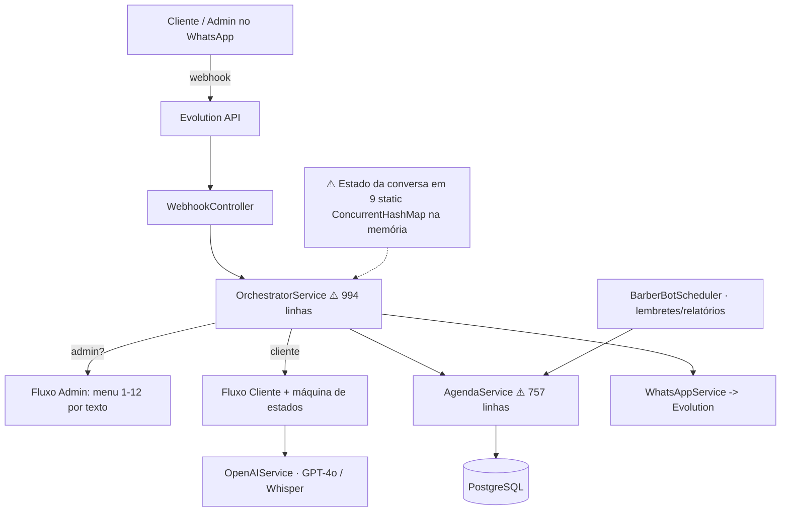
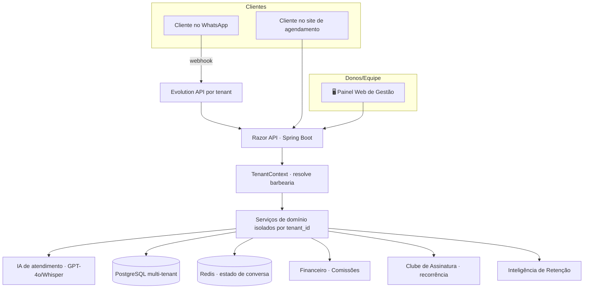

# 🏗️ Arquitetura — Razor

Este documento descreve a arquitetura **atual** (herdada do `barberbot-core`) e a
arquitetura **alvo** (SaaS multi-tenant). Serve de mapa para as fases do
[ROADMAP](./ROADMAP.md).

---

## 1. Stack

- **Backend:** Java 17, Spring Boot 3.2, Spring Data JPA.
- **Banco:** PostgreSQL + Flyway (migrações versionadas).
- **IA:** OpenAI GPT-4o (conversa + Vision) e Whisper (áudio), via LangChain4j / cliente próprio.
- **Mensageria:** Evolution API (gateway não-oficial de WhatsApp) via webhook.
- **Build:** Maven (`mvnw`). Deploy atual: EC2 + Docker Compose.

---

## 2. Arquitetura ATUAL (single-tenant)

Todo o atendimento acontece pelo WhatsApp. Não há painel web; a "gestão" é feita por
comandos de texto que o número do admin envia ao próprio bot.

### Modelo de dados atual

| Tabela | Papel | Observação crítica |
|---|---|---|
| `customers` | Cliente final | `phone_number` **UNIQUE global** → bloqueia multi-tenant |
| `interactions` | Histórico de conversa (contexto da IA) | FK para customer |
| `appointments` | Agendamentos | data/hora como **String** "DD/MM"; pagamento **String** |
| `scheduled_tasks` | Motor de lembretes/pesquisa | por telefone, sem tenant |
| `waitlist_entries` | Lista de espera reativa | por dia da semana (texto) |

### Problemas estruturais (resolvidos na Fase 0)
- **God classes**: `OrchestratorService` e `AgendaService` concentram roteamento,
  regra de negócio, formatação de WhatsApp, persistência e parsing de IA.
- **Estado na memória**: 9 `static Map` guardam o estado de cada conversa → perde tudo
  ao reiniciar e impede rodar mais de uma instância.
- **Parsing frágil da IA**: tags `[NOVO_AGENDAMENTO|...]` lidas por índice de array.
- **Erros engolidos**: `catch (Exception e) {}` vazios.

---

## 3. Arquitetura ALVO (multi-tenant SaaS)

Duas camadas de acesso sobre um núcleo multi-tenant:
**WhatsApp (atendimento do cliente)** e **Painel Web (gestão do dono)** — ambos operando
sobre os mesmos dados, isolados por barbearia.

### Duas caras, um núcleo
- **WhatsApp** = **atendimento** (cliente). Nosso diferencial: IA conversacional.
- **Painel Web** = **gestão** (dono/barbeiro): agenda multiprofissional, financeiro,
  comissões, assinaturas, relatórios, configuração da barbearia e do bot.
- **Site + agendamento online** = presença própria da marca (white-label).

> ⚠️ **Decisão de produto:** o Razor **não é "só WhatsApp"**. O painel web é obrigatório
> para competir com Frizzar/CashBarber — é onde mora a gestão que o barbeiro paga hoje.
> O WhatsApp é o que nos diferencia; o painel é o que nos dá paridade.

### Camada de plataforma (acima dos tenants)

Além dos três serviços de domínio, existe uma **camada de plataforma** para vender e operar
o SaaS (detalhes em [`PLATFORM.md`](./PLATFORM.md)):

- **Console do Dono (super-admin)** — papel `PLATFORM_OWNER` que enxerga através de todos os
  tenants: barbearias, MRR, churn, custo por tenant, provisionamento e suporte.
- **Site institucional `razor.com.br`** + **cadastro self-service** + **billing do SaaS** (gateway BR).
- **Provisionador** — cria o tenant e conecta o WhatsApp (QR code remoto) ao confirmar pagamento.
- **`WhatsAppGateway`** (interface) — isola o canal (Evolution API ↔ Cloud API oficial) para
  trocar de provedor sem tocar no núcleo. Ver trade-off de custo/risco em [`PRICING.md`](./PRICING.md)
  e [`PLATFORM.md`](./PLATFORM.md#4-canal-de-whatsapp).

### Evolução do modelo de dados

| Fase | Mudança |
|---|---|
| **1** | Nova tabela `barbershops` (tenant). `tenant_id` em todas as tabelas. `UNIQUE(tenant_id, phone_number)`. Novas: `professionals`, `services`. |
| **2** | `transactions`/`commands` (comandas), `commissions`, `subscription_plans`, `subscriptions`, `products` (estoque). |
| **3** | Configuração de site/marca por tenant; usuários do painel web (`users`, papéis). |
| **5** | Estado de conversa em Redis (sai dos `static Map`). |

---

## 4. Convenções

- **Flyway** para toda mudança de schema — nunca alteração manual.
- **Isolamento de tenant** aplicado na camada de acesso a dados (nunca confiar no cliente).
- **Arquivos pequenos e coesos** (200–400 linhas típico; 800 teto).
- **Tipos fortes** no domínio (datas, enums) em vez de String solta.

---

_Documento vivo — atualizado conforme as fases avançam._
