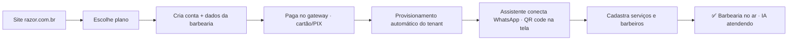

# 🛰️ Plataforma Comercial — Razor

> Como o Razor é **vendido e entregue 100% via web**, sem visita presencial, e como
> **você (dono da plataforma)** controla tudo: barbearias, faturamento, planos e suporte.

Relacionado: [ROADMAP](./ROADMAP.md) · [ARCHITECTURE](./ARCHITECTURE.md) · [PRICING](./PRICING.md)

---

## 1. Os três atores

| Ator | Acesso | Objetivo |
|---|---|---|
| **Você — dono da plataforma** | Console do Dono (super-admin) | Vender, provisionar, faturar, dar suporte, ver tudo |
| **Barbeiro — dono do tenant** | Painel web da barbearia + WhatsApp admin | Gerir a própria barbearia |
| **Cliente final** | WhatsApp + site da barbearia | Ser atendido |

---

## 2. Console do Dono (super-admin) — "acesso completo"

Área exclusiva sua, acima de todas as barbearias:

- **Visão geral do negócio:** nº de barbearias, MRR (receita recorrente), churn, novas assinaturas.
- **Lista de barbearias (tenants):** status (ativa/trial/inadimplente/cancelada), plano, uso.
- **Faturamento do SaaS:** quem pagou, quem está devendo, próximas cobranças.
- **Custo por tenant:** consumo de IA/WhatsApp de cada barbearia → detectar quem dá prejuízo (ver [PRICING §5](./PRICING.md#5-alavancas-para-nunca-ter-prejuízo)).
- **Provisionamento:** criar/suspender/reativar barbearia; reconectar WhatsApp.
- **Suporte:** entrar no contexto de um tenant (impersonar com trilha de auditoria) para ajudar.
- **Planos e cupons:** criar planos, promoções, períodos de teste (ex.: cupom `BETA30`).
- **Logs ao vivo:** stream dos logs da aplicação com filtro por tenant/nível — "ver o
  sistema rodando" e agir quando algo quebrar (spec em [`UX_BLUEPRINT §6`](./UX_BLUEPRINT.md)).
- **Saúde & backups:** semáforo de uptime/fila/erros e status do backup diário do banco
  (com "backup agora" e teste de restauração periódico).

> Tecnicamente é o mesmo backend multi-tenant, com um **papel `PLATFORM_OWNER`** que
> enxerga através dos tenants (os demais papéis ficam presos ao próprio `tenant_id`).

### Custos de IA e WhatsApp são da PLATAFORMA (não do tenant)

- A **chave da OpenAI é global e do Razor** (`OPENAI_API_KEY` no ambiente do deploy) —
  o barbeiro **nunca** configura/paga IA diretamente; o custo está embutido na mensalidade.
- Hoje isso já é assim no código (config global). O que o console do dono adiciona é a
  **visibilidade e o controle**: consumo de IA por tenant, alerta de custo, cota fair-use
  por plano e suspensão de tenant abusivo. Idem para o canal de WhatsApp (Evolution/Cloud API).
- Console do dono = onde você vê **todas as barbearias e instâncias** (status da conexão,
  plano, uso, custo) — hoje isso só é visível no banco/Evolution manager.

---

## 3. Venda e entrega self-service (sem ir na cidade)

Fluxo em que o barbeiro se torna cliente sozinho, pela web:

Cada etapa é **100% remota**:

1. **Site institucional** (`razor.com.br`) — apresenta o produto, planos, prova social, CTA.
2. **Cadastro** — cria o tenant (barbearia) e o primeiro usuário admin.
3. **Pagamento** — gateway brasileiro (Asaas / Mercado Pago / Stripe) com cartão ou PIX; assinatura recorrente.
4. **Provisionamento automático** — ao confirmar pagamento, o sistema cria o tenant e a
   instância de WhatsApp. O isolamento entre barbearias é **por linha** (`barbershop_id`) em
   **schema compartilhado** — um único banco atende todas as barbearias; **não** há um banco
   físico por tenant. É o padrão que dilui o custo de infra (ver [PRICING §2.3](./PRICING.md)).
5. **Conexão do WhatsApp por QR code** — o barbeiro **escaneia um QR na própria tela** com o
   celular da barbearia. É isso que substitui a visita presencial. ✅ *Já implementado no
   painel* (`/api/admin/whatsapp` + card "Conexão do WhatsApp" em Configurações).
6. **Onboarding guiado** — cadastra serviços (preço/duração), barbeiros e horários.
7. **No ar** — a IA começa a atender no WhatsApp da barbearia.

> **Início pragmático:** enquanto o self-service completo não está pronto, o
> provisionamento pode ser **manual** (você cria o tenant e conecta o WhatsApp para o
> cliente). A arquitetura já nasce pronta para automatizar isso depois. _("No começo vai
> ser apenas uma, mas vamos criar algo incrível.")_

---

## 4. Canal de WhatsApp

Decisão central que afeta custo, risco e a experiência de entrega:

| Opção | Custo | Risco | Provisionamento |
|---|---|---|---|
| **Evolution API** (atual, não-oficial) | Grátis (só infra) | **Banimento do número** | QR code — fácil de automatizar |
| **WhatsApp Cloud API** (oficial Meta) | Resposta grátis; template ~US$ 0,008 | Estável, sem ban | Onboarding via Meta (mais burocrático) |

**Estratégia recomendada:** começar com **Evolution API** (rápido, barato, MVP com poucas
barbearias) e **migrar para a Cloud API oficial** conforme escala e a estabilidade vira
requisito de venda. O código deve isolar o canal atrás de uma interface (`WhatsAppGateway`)
para trocar o provedor sem reescrever o núcleo.

---

## 5. Site institucional do Razor

Diferente do site de cada barbearia (white-label, Fase 3). Este vende **o SaaS**:

- **Landing** com a proposta: "o barbeiro digital que atende e gere sua barbearia".
- **Planos e preços** (ver [PRICING](./PRICING.md)).
- **Demonstração** do atendimento por IA (o diferencial).
- **Prova social** (depoimentos, nº de barbearias).
- **CTA de cadastro** → funil self-service da §3.
- **Blog/SEO** para captação orgânica (como Frizzar faz).

A **identidade visual** (logo, paleta, tom) para este site está em [BRANDING](./BRANDING.md).

---

## 6. Domínios: são dois sites diferentes

Não confundir os dois endereços web da plataforma:

| Endereço | Dono | Função | Fase |
|---|---|---|---|
| **`razor.com.br`** | Razor (você) | Site **institucional** que vende o SaaS (funil de assinatura) | 4 |
| **`<slug>.razor.com.br`** (ex.: `barbeariaficticia.razor.com.br`) | cada barbearia | Site **white-label** da barbearia (marca + agendamento online) | 3 |

**Como o subdomínio se resolve (encaixa na arquitetura atual):**

- Cada barbearia já tem um **`slug` único** (`barbershops.slug`) — foi criado justamente para
  ser identidade de URL. O subdomínio é o próprio slug: `barbeariaficticia.razor.com.br`.
- O tenant é resolvido pelo **`Host` header** → `slug` → `barbershop_id`, exatamente como o
  `TenantResolver` já faz hoje para a **instância de WhatsApp** de entrada. É o mesmo padrão,
  outra chave de entrada.
- **Infra necessária (nova):** DNS **wildcard** `*.razor.com.br` + certificado **TLS wildcard**,
  para novos tenants funcionarem sem provisionar DNS/cert um a um.
- **Slugs reservados:** `www`, `app`, `api`, `admin`, `console` etc. não podem virar barbearia
  (validar no cadastro; o slug já é `UNIQUE` no banco).
- **Domínio próprio** (`barbeariaficticia.com.br`, sem o `razor`) fica para depois — exige
  automação de TLS por domínio (Let's Encrypt). Começar só com subdomínio.

**Estado atual (sem domínio ainda):** o site e o agendamento online rodam por **caminho** na
mesma origem do painel — `/b/<slug>` e `/b/<slug>/agendar`. O subdomínio fica para quando o
domínio existir. O que já foi preparado para ele: o slug do onboarding é validado como rótulo DNS
(`[a-z0-9]`, hífen só no meio, até 63). Rotas públicas da API: `GET /api/site/{slug}`,
`GET /api/site/{slug}/booking`, `GET /api/site/{slug}/booking/slots`, `POST /api/site/{slug}/booking`.

**Segurança da mesma origem:** como o site divide a origem com o painel, toda URL que o dono
cadastra (logo, capa, galeria, Instagram, mapa) só é aceita em `https://` (Instagram só
`instagram.com`, mapa só Google Maps) — `SiteUrlPolicy` no backend — e a página filtra de novo
ao renderizar (`safeHttpUrl`/`sanitizeSite`), cobrindo dado gravado antes da regra.

### Templates do site white-label (modelo de negócio)

O site da barbearia **não é um site builder livre** — é um sistema de templates controlado
pela plataforma:

- **3 templates prontos** inclusos em todo plano, com direções distintas de **layout**
  (não de cor): **Clássico**, **Estúdio**, **Vitrine**. O tenant **escolhe 1** no painel e
  preenche só **conteúdo**: logo, fotos, textos e a cor de destaque — nunca código.
- **Tema é escolha separada e vale para os 3**: ☀️ Claro · 🌙 Escuro · ◐ **Ambos** (padrão:
  segue o aparelho do visitante + botão de alternância no site). Cada template já vem com as
  **duas paletas testadas** (contraste AA), derivadas da cor de destaque escolhida — assim o
  dono não consegue montar uma combinação ilegível.
- **Template personalizado** = serviço **avulso** (one-time, sob consulta — [PRICING §3](./PRICING.md)):
  nosso time desenha um tema exclusivo para aquela barbearia.
- **O código dos templates é 100% nosso e centralizado**: um template é um *tema versionado
  no repositório* que renderiza os dados do tenant (serviços, equipe, fotos, avaliações).
  Corrigiu/melhorou o template → **todas** as barbearias que o usam recebem a atualização.
  O tenant não injeta HTML/JS (sem XSS, sem site quebrado, sem suporte de "meu site sumiu").
- Modelo de dados (Fase 3): `barbershop_site` (template_id, logo, fotos, textos, cores,
  redes) + os dados que já existem (serviços, equipe). Página de agendamento usa a mesma
  agenda do bot.

---

## 7. Os dois níveis de "plano" (não confundir)

A palavra *plano* aparece em dois lugares que **não** têm relação:

| | Quem assina | De quem | O que controla | Status |
|---|---|---|---|---|
| **Plano do Razor** (Solo/Equipe/Pro) | o **barbeiro** | do Razor | libera **features** do sistema (entitlement/tier) | ⬜ a construir (Fase 4) |
| **`subscription_plans`** (VIP/Silver) | o **cliente final** | da barbearia | clube de assinatura da barbearia | ✅ existe (catálogo + assinantes) |

O tier do Razor (o que o barbeiro paga) precisa ser um conceito **novo** — provavelmente um
`plan_tier` em `barbershops` com **feature-gating no servidor**. **Não** reaproveitar a tabela
`subscription_plans`, que é o clube da barbearia para os clientes dela.

---

## 8. O que isso adiciona ao roadmap

Esta camada vira a **Fase 4 — Plataforma Comercial** no [ROADMAP](./ROADMAP.md), depois do
multi-tenant (Fase 1) e da gestão (Fase 2/3), porque depende deles existirem. Inclui:
console do dono, billing do SaaS, provisionamento automático e o site institucional.

---

_Documento vivo._
