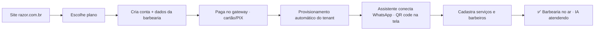

# 🛰️ Plataforma Comercial — Razor

> Como o Razor é **vendido e entregue 100% via web**, sem visita presencial, e como
> **você (dono da plataforma)** controla tudo: barbearias, faturamento, planos e suporte.

Relacionado: [ROADMAP](./ROADMAP.md) · [ARCHITECTURE](./ARCHITECTURE.md) · [PRICING](./PRICING.md)

---

## 1. Os três atores

| Ator | Acesso | Objetivo |
|---|---|---|
| **Você — dono da plataforma** | Console do Dono (super-admin) | Vender, provisionar, faturar, dar suporte, ver tudo |
| **Barbeiro — dono do tenant** | Painel web da barbearia + WhatsApp admin | Gerir a própria barbearia |
| **Cliente final** | WhatsApp + site da barbearia | Ser atendido |

---

## 2. Console do Dono (super-admin) — "acesso completo"

Área exclusiva sua, acima de todas as barbearias:

- **Visão geral do negócio:** nº de barbearias, MRR (receita recorrente), churn, novas assinaturas.
- **Lista de barbearias (tenants):** status (ativa/trial/inadimplente/cancelada), plano, uso.
- **Faturamento do SaaS:** quem pagou, quem está devendo, próximas cobranças.
- **Custo por tenant:** consumo de IA/WhatsApp de cada barbearia → detectar quem dá prejuízo (ver [PRICING §5](./PRICING.md#5-alavancas-para-nunca-ter-prejuízo)).
- **Provisionamento:** criar/suspender/reativar barbearia; reconectar WhatsApp.
- **Suporte:** entrar no contexto de um tenant (impersonar com trilha de auditoria) para ajudar.
- **Planos e cupons:** criar planos, promoções, períodos de teste.

> Tecnicamente é o mesmo backend multi-tenant, com um **papel `PLATFORM_OWNER`** que
> enxerga através dos tenants (os demais papéis ficam presos ao próprio `tenant_id`).

---

## 3. Venda e entrega self-service (sem ir na cidade)

Fluxo em que o barbeiro se torna cliente sozinho, pela web:

Cada etapa é **100% remota**:

1. **Site institucional** (`razor.com.br`) — apresenta o produto, planos, prova social, CTA.
2. **Cadastro** — cria o tenant (barbearia) e o primeiro usuário admin.
3. **Pagamento** — gateway brasileiro (Asaas / Mercado Pago / Stripe) com cartão ou PIX; assinatura recorrente.
4. **Provisionamento automático** — ao confirmar pagamento, o sistema cria o tenant, o banco isolado por `tenant_id`, e a instância de WhatsApp.
5. **Conexão do WhatsApp por QR code** — o barbeiro **escaneia um QR na própria tela** com o celular da barbearia. É isso que substitui a visita presencial.
6. **Onboarding guiado** — cadastra serviços (preço/duração), barbeiros e horários.
7. **No ar** — a IA começa a atender no WhatsApp da barbearia.

> **Início pragmático:** enquanto o self-service completo não está pronto, o
> provisionamento pode ser **manual** (você cria o tenant e conecta o WhatsApp para o
> cliente). A arquitetura já nasce pronta para automatizar isso depois. _("No começo vai
> ser apenas uma, mas vamos criar algo incrível.")_

---

## 4. Canal de WhatsApp

Decisão central que afeta custo, risco e a experiência de entrega:

| Opção | Custo | Risco | Provisionamento |
|---|---|---|---|
| **Evolution API** (atual, não-oficial) | Grátis (só infra) | **Banimento do número** | QR code — fácil de automatizar |
| **WhatsApp Cloud API** (oficial Meta) | Resposta grátis; template ~US$ 0,008 | Estável, sem ban | Onboarding via Meta (mais burocrático) |

**Estratégia recomendada:** começar com **Evolution API** (rápido, barato, MVP com poucas
barbearias) e **migrar para a Cloud API oficial** conforme escala e a estabilidade vira
requisito de venda. O código deve isolar o canal atrás de uma interface (`WhatsAppGateway`)
para trocar o provedor sem reescrever o núcleo.

---

## 5. Site institucional do Razor

Diferente do site de cada barbearia (white-label, Fase 3). Este vende **o SaaS**:

- **Landing** com a proposta: "o barbeiro digital que atende e gere sua barbearia".
- **Planos e preços** (ver [PRICING](./PRICING.md)).
- **Demonstração** do atendimento por IA (o diferencial).
- **Prova social** (depoimentos, nº de barbearias).
- **CTA de cadastro** → funil self-service da §3.
- **Blog/SEO** para captação orgânica (como Frizzar faz).

A **identidade visual** (logo, paleta, tom) para este site está em [BRANDING](./BRANDING.md).

---

## 6. O que isso adiciona ao roadmap

Esta camada vira a **Fase 4 — Plataforma Comercial** no [ROADMAP](./ROADMAP.md), depois do
multi-tenant (Fase 1) e da gestão (Fase 2/3), porque depende deles existirem. Inclui:
console do dono, billing do SaaS, provisionamento automático e o site institucional.

---

_Documento vivo._
